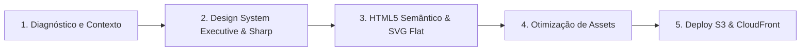

# ⚡ Ponto de Partida Obrigatório de Sessão — JC Botelho
> **Arquivo Central de Inicialização para Agentes de IA (Antigravity / Gemini / Claude)**  
> **Status:** Ativo & Mandatório  
> **Última Atualização:** Novembro/2026

Toda nova sessão de desenvolvimento, análise, refatoração ou criação de código no projeto **jcbotelho.com** DEVE iniciar por este documento. Ele consolida os princípios de qualidade, a estética executiva geométrica afiada ("Executive & Sharp") e o pipeline de publicação estática de alta performance.

---

## 🚦 Portões de Qualidade & Pré-Requisitos Mandatórios (Checklist de Boot)

Antes de propor ou executar qualquer modificação no código-fonte, o agente DEVE validar mentalmente e seguir estes 5 portões de qualidade:

1. **Portão 1: Invariante Estética "Executive & Sharp"**
   - Paleta escura minimalista: Fundo `--bg-primary: #09090b`, `--bg-secondary: #111114`, cards `--bg-card: #15151a`, textos `#f4f4f6` e acentos monocromáticos elegantes.
   - Cantos estritamente afiados: `--radius: 0px` (zero border-radius arredondado padrão; geometria cirúrgica).
   - Tipografia: `Plus Jakarta Sans` para títulos e identidade executiva; `Inter` para corpo e leitura densa.
   - Ícones profissionais: Uso exclusivo de ícones flats SVG puros. **É proibido o uso de emojis** em seções executivas.

2. **Portão 2: HTML5 Semântico & Acessibilidade**
   - Estrutura clara com tags semânticas (`<header>`, `<nav>`, `<main>`, `<section>`, `<article>`, `<footer>`).
   - Todos os botões e links interativos devem possuir estados `:hover`, `:focus-visible` e atributos de acessibilidade (`aria-label` onde aplicável).

3. **Portão 3: Pipeline de Compressão e Otimização de Imagens**
   - Toda nova imagem ou alteração gráfica deve passar pelo script de compressão:
     `python3 compress_assets.py --in-place`
   - Otimização automática para WebP e tamanhos reduzidos sem degradação visual.

4. **Portão 4: SEO, Metadados & Manifest**
   - Preservar tags OpenGraph, Twitter Cards, `canonical`, `sitemap.xml` e `site.webmanifest` em todas as páginas públicas (`index.html`, `curriculo.html`, `revista-aterrorizante.html`, `404.html`).

5. **Portão 5: Publicação & Invalidação CloudFront**
   - Deploy automatizado executado via:
     `./publish.sh`
   - Sincroniza os arquivos estáticos com o bucket `s3://jcbotelho.com` e invalida o cache global na distribuição CloudFront `EFTEVO3P436H1`.

---

## 🗺️ Mapa da Base de Conhecimento em `.agents/`

Navegue diretamente pelos módulos especializados:

### 📐 Especificações Técnicas Vivas (`.agents/specs/`)
- [`core-architecture.md`](file:///Users/joaoclaudiobotelhorosa/Desktop/Projects/jcbotelho/.agents/specs/core-architecture.md): Topologia CloudFront + S3, catálogo de páginas estáticas e esteira de publicação.

### ⚖️ Regras de Engenharia & Diretrizes (`.agents/rules/`)
- [`ui-and-tokens.md`](file:///Users/joaoclaudiobotelhorosa/Desktop/Projects/jcbotelho/.agents/rules/ui-and-tokens.md): Tokens do Design System "Executive & Sharp", tipografia, variáveis CSS e padrões de botões/cards.
- [`seo-and-performance.md`](file:///Users/joaoclaudiobotelhorosa/Desktop/Projects/jcbotelho/.agents/rules/seo-and-performance.md): Diretrizes de metatags, cache estático, sitemap e compressão de mídia.
- [`code-quality-and-gates.md`](file:///Users/joaoclaudiobotelhorosa/Desktop/Projects/jcbotelho/.agents/rules/code-quality-and-gates.md): Checklist de entrega, validação de links e garantia de integridade visual.

### 🛠️ Skills & Ferramental Prático (`.agents/skills/`)
- [`session-init-checklist.md`](file:///Users/joaoclaudiobotelhorosa/Desktop/Projects/jcbotelho/.agents/skills/session-init-checklist.md): Roteiro sequencial de 5 minutos para iniciar qualquer tarefa no portfólio.
- [`test-runner.md`](file:///Users/joaoclaudiobotelhorosa/Desktop/Projects/jcbotelho/.agents/skills/test-runner.md): Comandos para pré-visualização local e deploy seguro.

---

## ⚡ Comandos Rápidos de Ambiente
- Testar localmente: `python3 -m http.server 8080` (abre em `http://localhost:8080`)
- Otimizar imagens: `python3 compress_assets.py --in-place`
- Deploy seguro em produção: `./publish.sh`

