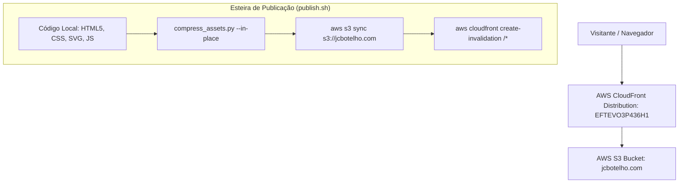

# Arquitetura Central & Esteira de Publicação — JC Botelho

> **Status:** Ativo & Em Produção  
> **Última Atualização:** Novembro/2026

---

## 1. Topologia de Infraestrutura

O site oficial de JC Botelho é uma aplicação estática de altíssima performance hospedada diretamente em AWS S3 com distribuição global via Amazon CloudFront:

---

## 2. Catálogo de Páginas & Recursos

1. **`index.html`**: Página principal do portfólio executivo. Apresenta posicionamento de liderança técnica, engenharia de sistemas de missão crítica, autor e criador de universos narrativos, além de cases e competências essenciais.
2. **`curriculo.html`**: Currículo executivo detalhado. Apresenta a esteira de evolução de cargos na empresa (`career-ladder`), histórico profissional em grandes corporações financeiras (Itaú Unibanco, Redecard), formação acadêmica e certificações.
3. **`revista-aterrorizante.html`**: Apresentação editorial de contos, antologias e projetos literários de terror e suspense.
4. **`404.html`**: Página personalizada de erro amigável mantendo a identidade visual e navegação de retorno.
5. **`styles.css`**: Folha de estilo monolítica e modularizada por seções, com variáveis completas do tema dark sharp.
6. **`compress_assets.py`**: Utilitário em Python para conversão inteligente e compressão sem perda perceptível de mídia gráfica.

